<p align="center">
  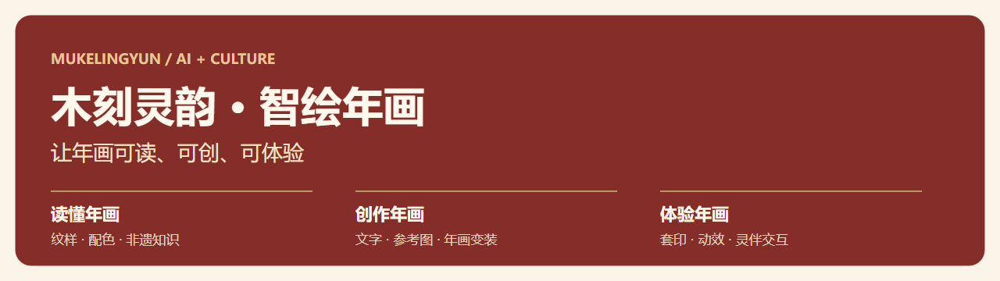
</p>

<p align="center"><strong>面向木版年画文化学习与 AI 辅助创作的交互平台</strong></p>
<p align="center">纹样知识 · 个性创作 · 年画变装 · 套印体验 · 动态展示</p>
<p align="center">
  <a href="#项目亮点">项目亮点</a> ·
  <a href="#功能全景">功能全景</a> ·
  <a href="#界面与成果">界面与成果</a> ·
  <a href="#使用流程">使用流程</a> ·
  <a href="#技术实现">技术实现</a> ·
  <a href="#快速开始">快速开始</a>
</p>

## 为什么做这个项目

一张年画里，有人物故事、吉祥寓意，也有刻版与套色的手艺。木刻灵韵希望把这些文化内容连接到今天的学习和创作中：用户可以先读懂纹样与配色，再表达自己的想法，尝试创作年画、体验叠印，让静态作品拥有新的展示方式。

项目以开封、朱仙镇木版年画文化为重要内容基础，提供 **“读懂年画—创作年画—体验年画”** 的使用路径，面向非遗学习、个人创作、研学展示与文化探索等场景。

## 项目亮点

- **文化元素进入创作**：浏览纹样、传统配色与寓意，将所选内容衔接到创作页面，让想法有文化参考。
- **双图年画变装**：人物照片提供面容参考，年画图片提供服饰与构图，再通过风格化重绘尝试统一墨线、设色与纸感。
- **看得见的套印过程**：把图像分为轮廓、暗部与色彩层，支持拖拽叠加、自动整合和逐层体验。
- **从静态到动态**：用文字描述希望变化的区域与方式，创建视频任务，查看进度并保存结果。
- **有入口，也有陪伴**：工作台组织功能与任务；三维木灵提供快捷入口、文化问答及受浏览器支持的语音交互。

> **自备密钥，按需调用。** 仓库不附带开发者密钥。需要调用模型或地图服务时，请使用自己的账号与配置；不依赖外部服务的知识浏览、套印等交互可以先体验。

## 功能全景

| 体验方向 | 模块 | 可以做什么 |
| :--- | :--- | :--- |
| 读懂年画 | **文脉藏珍** | 浏览纹样、吉祥寓意与传统配色，将选择衔接到创作。 |
| 读懂年画 | **遗韵拾光** | 学习年画历史、流派、制作工艺与民俗，进行文化问答。 |
| 读懂年画 | **寻迹山河** | 围绕文化地点组织探索任务，结合地图、图片识别与问答。 |
| 创作年画 | **墨韵生花** | 从生活中的想法、文字或参考图出发，完成规划、检索、生成与检查。 |
| 创作年画 | **木韵新绘** | 选择年画流派、题材、纹样与色彩，组织年画创作需求。 |
| 创作年画 | **年画变装** | 上传单人人像，选择平台年画或自定义参考，生成风格化肖像。 |
| 创作拓展 | **古筑绘影** | 组织古建筑题材与传统美术风格的辅助创作。 |
| 体验年画 | **墨痕留印** | 分离图像层、拖拽组合、逐层叠印，理解套色的视觉过程。 |
| 体验年画 | **光影新生** | 描述局部动效，分析画面、创建异步视频任务并预览结果。 |
| 体验年画 | **H5 互动体验** | 从平台入口进入外部年画工艺互动体验。 |
| 陪伴与管理 | **灵伴相随 / 印记长存 / 个人中心** | 三维陪伴、功能跳转、作品与生成记录展示，以及版权渠道说明。 |

## 界面与成果

### 一个工作台，连接文化探索与创作

专业功能集中在侧边栏，用户可以从一句具体需求出发，也可以直接进入独立页面。当前任务、功能入口和创作记录帮助衔接操作。

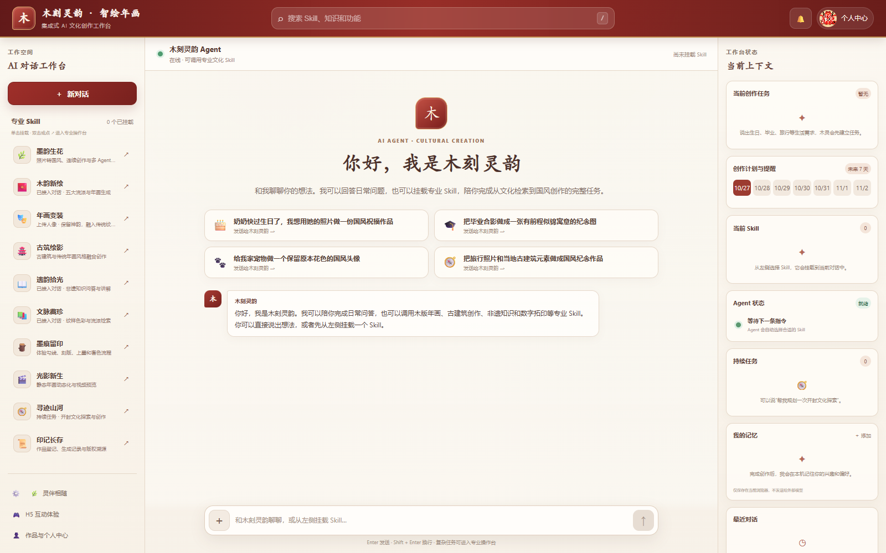

### 读懂纹样，再把它用进作品

文脉藏珍展示人物服饰纹、吉祥瑞兽纹与装饰底纹；墨韵生花则把文字想法和参考图片组织成创作任务。

<table>
  <tr><th width="50%">文脉藏珍 · 纹样知识</th><th width="50%">墨韵生花 · 创作入口</th></tr>
  <tr>
    <td>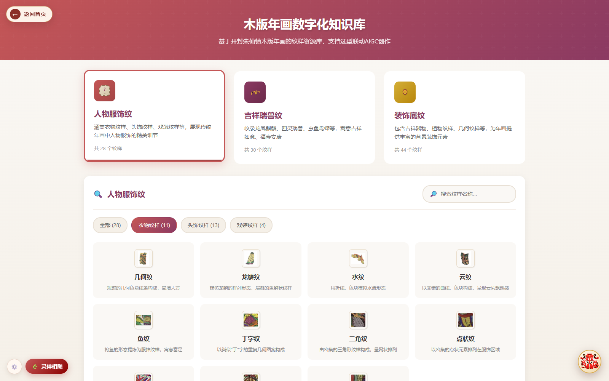</td>
    <td>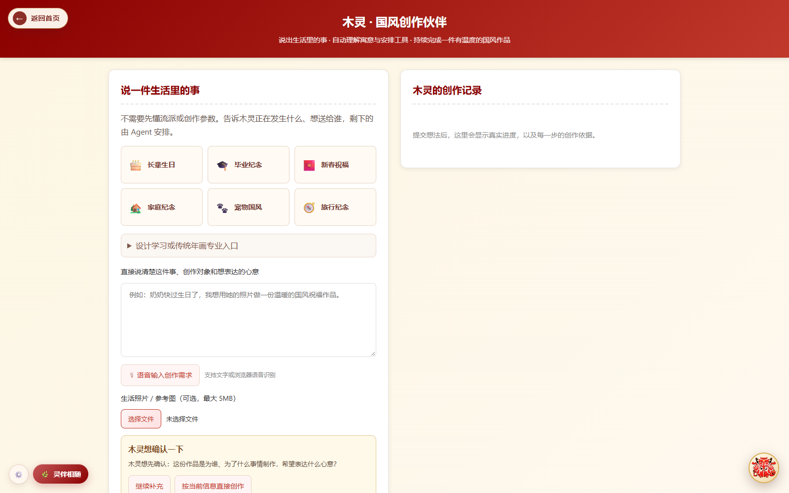</td>
  </tr>
</table>

### 年画变装：以你的面容为形，以年画为衣

支持选择平台年画、了解其故事，也支持上传自己的参考图。人物照片与年画参考共同参与生成，再进行风格化处理，尝试让人物融入年画的构图和色彩体系。

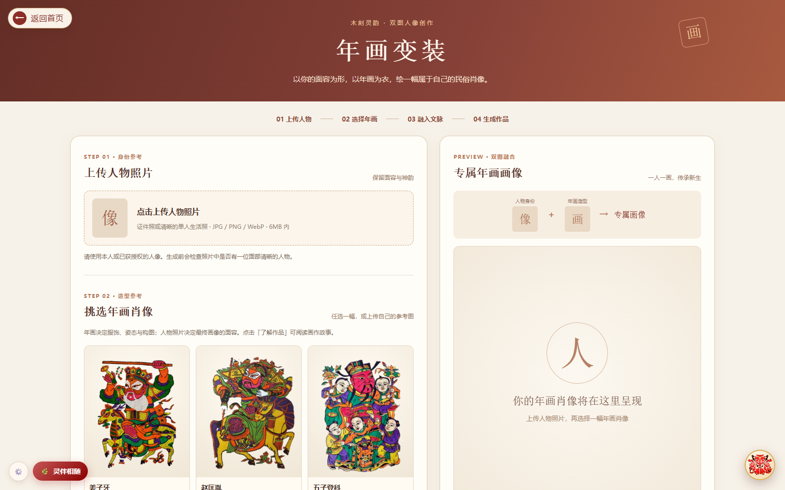

<table>
  <tr><th width="50%">年画造型参考</th><th width="50%">历史演示中的生成结果</th></tr>
  <tr>
    <td align="center"></td>
    <td align="center">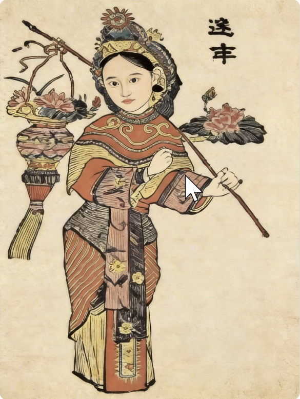</td>
  </tr>
</table>

*结果图截取自项目已有演示录屏；人物输入照片不在此展示。示例用于说明创作方向，不保证每次生成具有相同的相似度、比例或风格效果。*

### 墨痕留印：把套印过程变成可操作的体验

上传图片后，在浏览器中提取轮廓线稿、暗部线条和主要色彩层。可以逐层加入，也可以自动整合，观察不同图层共同构成画面的过程。

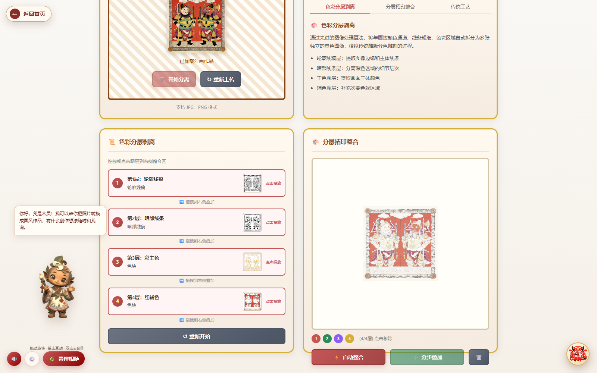

### 光影新生：让年画拥有动态展示方式

从“云雾流动”“衣袖轻摆”等要求出发，整理动作方式、作用范围和保留内容；一般图片通过模型创建异步视频任务。

<p align="center">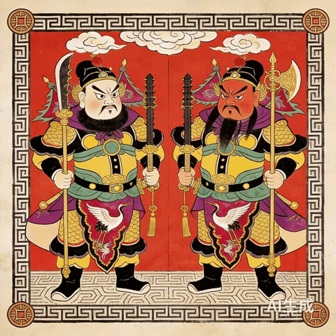</p>

*上方为项目已有的**门神预置演示视频**片段，展示动效形式；不是本次截图时实时调用模型生成的结果。指定门神图匹配预置视频，其他图片按现有模型生成流程处理。*

### 灵伴相随：把文化问答和创作入口带在身边

三维木灵支持拖动查看、单击互动和快捷跳转；在浏览器支持时，可使用语音识别与朗读。它帮助用户找到功能、继续任务，也让平台多一点陪伴感。

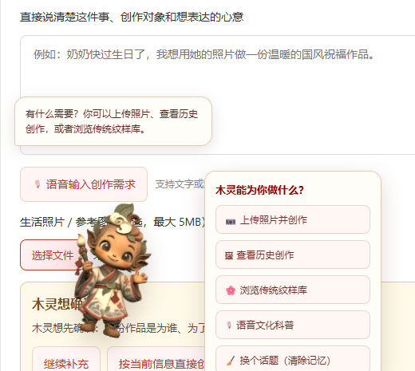

[查看其余界面与图片来源 →](docs/GALLERY.md)

## 使用流程

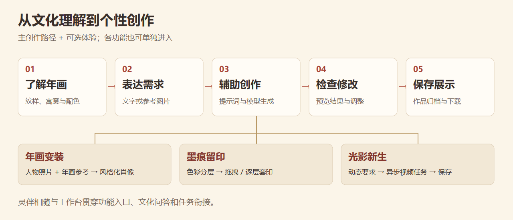

第一次使用，可以先浏览文脉藏珍，再体验不需要模型密钥的墨痕留印；准备好自己的模型配置后，再进入年画创作、变装或动效生成。

## 技术实现

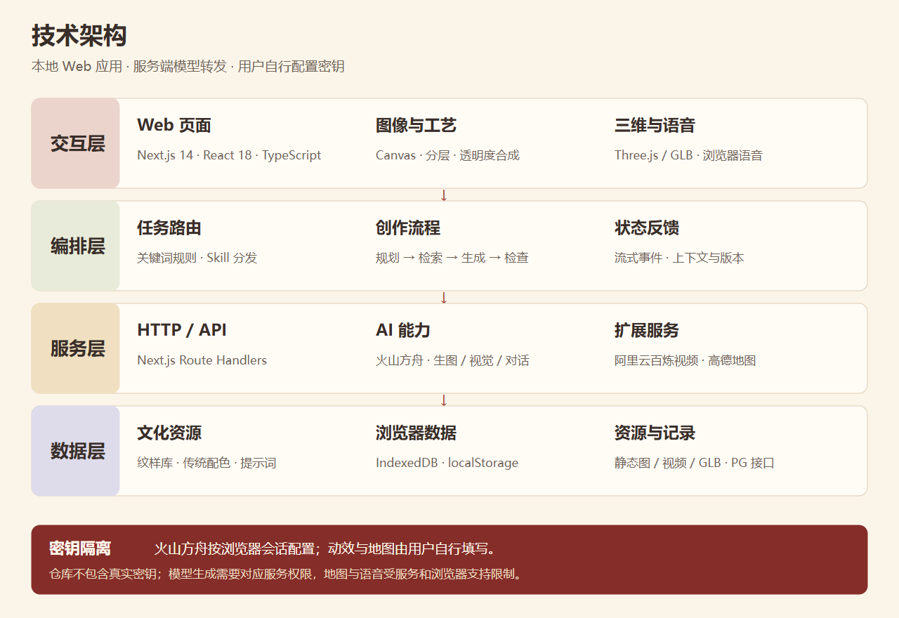

| 层次 | 当前使用的方案 |
| :--- | :--- |
| 页面与交互 | Next.js 14、React 18、TypeScript；以路由组织各功能页面。 |
| 创作编排 | 关键词规则路由与 Skill 分发；墨韵生花串联规划、资料检索、提示词组织、生成及视觉检查，流式反馈任务状态。 |
| 文化参考 | 本地纹样资料、传统配色与提示词模板参与需求组织；当前检索以关键词与规则匹配为主。 |
| 图像与套印 | Canvas 图像处理；邻域灰度差、亮度阈值与颜色频次统计提取图层，再按透明度合成。 |
| 外部 AI 服务 | 火山方舟承担生图、视觉与对话调用；阿里云百炼承担图生视频异步任务。实际可用性取决于使用者账号、模型权限与地域。 |
| 三维与语音 | Three.js / GLB 展示木灵，浏览器语音 API 提供可用时的识别与朗读。 |
| 状态与记录 | IndexedDB、localStorage 保存浏览器侧任务与作品；部分作品和个人信息接口依赖 PostgreSQL 部署配置。 |

**能力说明：** 项目集成外部模型服务，不宣称自训练年画大模型。视觉检查属于模型辅助检查，不代替传承人或专家鉴定；版权服务目前提供页面引导与外部渠道说明，不代表已完成官方登记或链上存证。

## 快速开始

### 1. 获取项目

```sh
git clone https://github.com/fengyuhan54-coder/mukelingyun-nianhua.git
cd mukelingyun-nianhua
```

私有仓库需要先获得访问权限。准备好可用的 Node.js 与 pnpm 后，安装依赖并启动：

```sh
pnpm install
pnpm dev
```

浏览器打开 **http://localhost:5001**。

### 2. 按需配置自己的服务

| 服务 | 配置入口 | 用途 |
| :--- | :--- | :--- |
| 火山方舟 | 墨韵生花 → 模型服务配置 | 相关创作、年画变装、视觉理解与问答。 |
| 火山方舟 / 阿里云百炼 | 光影新生页面的服务配置 | 动态需求理解、视频生成；百炼还需业务空间与地域。 |
| 高德 Web 地图 | 寻迹山河 → 地图配置入口 | 地点检索、地图与导航等。 |

**不提供默认密钥，也不会自动使用开发者的本机密钥。** 火山方舟按当前浏览器会话独立配置；密钥使用方式、清除方法和部署注意事项见 [配置与密钥说明](docs/CONFIGURATION.md)。外部服务可能按各自规则计费，请使用自己的账号。

### 3. 常用命令

```sh
pnpm dev          # 本地开发，端口 5001
pnpm build        # 生产构建
pnpm start        # 启动已构建的应用
pnpm test:muling  # 创作流程离线测试
node --test scripts/test-user-credentials.cjs  # 密钥配置隔离测试
```

完整功能可能需要额外的模型权限、地图配置和数据库环境。源码托管并不等于网站已持续在线部署。

## 目录导航

```text
src/
├── app/                 # 工作台、各功能页面与 API 路由
├── components/          # 灵伴、导航、配置与任务组件
└── lib/                 # 创作流程、文化资料、图像与存储逻辑
public/
├── images/              # 页面及年画参考图片
├── models/              # 木灵 GLB 模型
└── videos/              # 工艺与动效演示视频
docs/                    # 展示图片、流程图与使用说明
scripts/                 # 测试及运行辅助脚本
```

## 应用方向与后续探索

- **非遗教育**：连接纹样寓意、文化问答与套印交互，为课堂和研学提供可操作的数字内容。
- **文旅体验**：结合文化地点探索与个性化年画创作，尝试形成与旅行体验有关的数字纪念作品。
- **文创传播**：辅助探索节庆贺卡、装饰画与动态展示素材，让传统年画进入日常表达。

后续希望继续补充资料来源、改善人像风格融合和局部动效、完善多用户部署与交互体验。这些属于迭代方向，不代表已落地的合作或效果承诺。

## 素材与使用说明

截图来自本地项目；作品示例来自已有项目演示；动效缩略图来自仓库预置视频。年画参考、第三方服务与其他素材的权利归相应权利人所有。人物创作请使用本人或已获授权的照片。

仓库目前未附开源许可证，公开访问不等于授予任意商用或再分发权。复用前请确认项目与具体素材的授权范围。

[文档与界面图](docs/GALLERY.md) · [密钥配置](docs/CONFIGURATION.md) · [如何更新仓库展示](docs/UPDATE_SHOWCASE.md)
