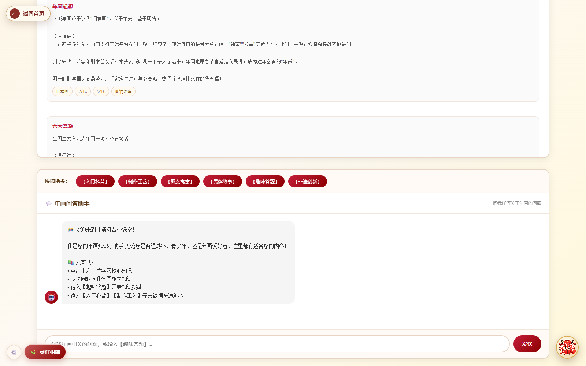
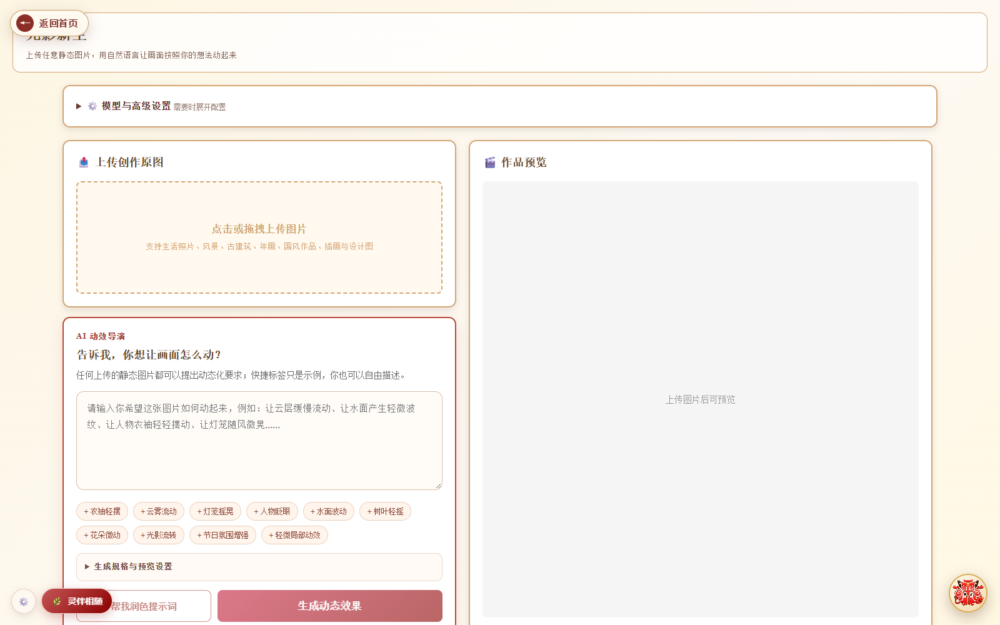
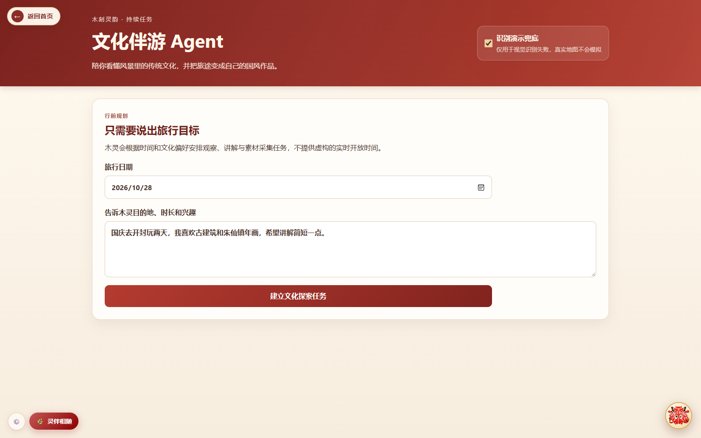

# 木刻灵韵 · 项目功能与界面图

[返回项目首页](../README.md) · [密钥配置](CONFIGURATION.md)

本页介绍木刻灵韵各模块的用途、操作路径与功能衔接。整体以“读懂年画—创作年画—体验年画”为主线。

## 1. AI 对话工作台：统一的功能入口

从一句需求出发，选择或挂载专业 Skill，组织文化问答与创作任务。左侧进入各功能，右侧查看当前任务、上下文与创作提醒。

## 2. 文脉藏珍：读懂纹样与传统配色

浏览人物服饰纹、吉祥瑞兽纹和装饰底纹，查看名称、视觉特征与文化寓意；选择纹样及色彩后，衔接到创作或年画变装。

**操作路径：** 选择纹样类别 → 搜索或查看元素 → 选择配色 → 同步到创作。

## 3. 遗韵拾光：了解年画背后的文化

从历史、流派、制作工艺、民俗与吉祥寓意等内容认识木版年画。知识浏览可以直接使用，模型问答需配置自己的火山方舟密钥。

**操作路径：** 浏览知识栏目 → 了解工艺或故事 → 围绕感兴趣的内容继续提问。

## 4. 墨韵生花：把生活中的想法变成创作需求

输入新春祝福、家庭纪念或旅行纪念等需求，可添加参考图片。创作流程组织规划、资料检索、图像生成与结果检查，并展示过程记录。

**操作路径：** 表达需求 → 按需补充参考图 → 配置模型服务 → 发起创作 → 查看、调整与保存作品。

## 5. 木韵新绘与古筑绘影：按题材组织专业创作

- **木韵新绘**：围绕年画流派、主题、纹样和传统色彩组织生成需求，适合明确题材的年画设计尝试。
- **古筑绘影**：围绕朝代、建筑类型与具体建筑等组织需求，探索古建筑和传统美术风格的结合。

这两个页面均有自己的 **API Token 配置** 入口，也可使用墨韵生花保存的同站点会话配置。详细步骤见 [密钥配置](CONFIGURATION.md)。

## 6. 年画变装：人物形象与年画造型相遇

上传单人人像，以平台年画或自定义图片作为服饰、姿态和构图参考；支持衔接文脉藏珍选中的纹样与配色。生成后继续进行风格化处理，尝试协调面部、线条、设色与纸感。

**操作路径：** 上传人物 → 选择年画 → 融入纹样配色 → 生成与查看。

| 年画造型参考 | 演示中的生成作品 |
| --- | --- |
|  |  |

## 7. 墨痕留印：观察年画如何逐层成形

上传图片，分离轮廓线稿、暗部线条、主色与辅助色。把图层拖到整合区，或通过自动整合与分步叠加观察不同图层的作用。

**操作路径：** 上传图片 → 开始分离 → 选择或拖拽图层 → 分步叠加 / 自动整合。

## 8. 光影新生：为静态作品设计动态表达

上传年画或其他图片，用文字说明动态要求；可辅助分析画面元素，细化动作、作用范围与保留部分，再创建视频任务、预览并保存。

**操作路径：** 上传原图 → 描述动态 → 按需分析 → 生成视频 → 查看和保存。

### 门神动效展示

以下片段来自平台已有的门神预置视频，用于展示效果。指定门神图匹配后播放预置视频；一般图片使用模型生成任务。

## 9. 寻迹山河：在文化探索中连接地点与作品

围绕开封文化地点安排探索任务，结合真实地图、地点信息、图片分析与问答，把旅行中的见闻继续转化为创作灵感。

**操作路径：** 提出探索目标 → 配置地图 → 查询地点 → 记录与提问 → 衔接创作。

## 10. 灵伴相随：三维木灵陪伴交互

木灵提供拖动查看、单击面板、快捷功能入口及任务衔接。文化问答使用用户自己的模型配置；语音识别与朗读依赖浏览器支持。

## 11. H5 互动体验：用指尖体验年画工序

从侧边栏进入 H5 页面，扫描二维码打开独立的年画互动体验，通过交互理解刻版、上墨与套色等制作环节。

## 12. 印记长存与个人中心：整理创作记录

围绕作品、历史记录与个人信息组织展示和管理；版权页面提供登记与第三方存证渠道说明。涉及服务端保存的部分需要对应数据库环境。

## 13. 功能流程与技术架构

### 从了解文化到创作体验

### 页面、编排、服务与数据

[返回项目首页](../README.md) · [查看各功能密钥配置](CONFIGURATION.md)
